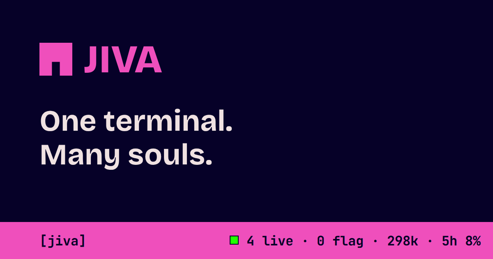

# JIVA — one terminal, many souls

[](https://github.com/MeiuxMeiux/jiva/actions/workflows/ci.yml)
[](LICENSE)
[](CHANGELOG.md)
[](https://jiva.meiuxmeiux.com)

<!-- blurb:begin -->
JIVA keeps a small fleet of Claude Code sessions alive in a private tmux server.
A desk talks to you, a boss splits the work, workers do it. A plain bash watchdog
checks every session every 5 seconds and swaps any of them for a fresh one before it
gets past 200k tokens of context.

You keep one window open. Questions reach you there. The rest of the
fleet stays out of your way.
<!-- blurb:end -->

Site: <https://jiva.meiuxmeiux.com> · Status: public alpha, runs on your machine.

[](https://jiva.meiuxmeiux.com)

**Why:** long Claude Code sessions drift, bloat their context and stall on prompts nobody sees.
JIVA treats sessions as disposable bodies: work lives in task cards, claims, an append-only board
and ≤40-line handoffs, so any session can die and a fresh one picks up where it left off.

[License (MIT)](LICENSE) · [Security](SECURITY.md) · [Contributing](CONTRIBUTING.md) ·
[Support](SUPPORT.md) · [Code of Conduct](CODE_OF_CONDUCT.md) · [Changelog](CHANGELOG.md)

## Install

Linux or WSL2. bash ≥4, git, tmux ≥3.2, jq ≥1.6, just, python3, util-linux (flock, setsid), coreutils, Claude Code. Optional: gh, shellcheck, gitleaks.
macOS: untested (needs Homebrew bash, coreutils, util-linux).

Clone and put `bin/` on PATH. No-install options: paste [JIVA Micro](docs/MICRO.md) into a repo (the walkthrough),
or the **JIVA Kit** (the same fleet as plain `.fleet/` files: roles, templates, `just` recipes, bash scripts;
`just kit KIT.md` in a checkout, or `kit.md` next to `micro.md` on the site):

```
git clone https://github.com/MeiuxMeiux/jiva ~/jiva    # or: gh repo clone MeiuxMeiux/jiva ~/jiva
export PATH="$HOME/jiva/bin:$PATH"
```

`bin/jiva` works from any repo (code comes from the checkout, state goes in that repo's `.jiva/`).
Inside the jiva checkout itself, `just --list` shows the same runtime as recipes (`just up`, `just status`,
`just down`) plus the verb wrappers `just j-*`.

**Permissions (read this first).** The fleet runs in hidden tmux panes, so any Claude Code permission
prompt stalls that session until you answer it (`jiva pending` lists them). Before `jiva up`, allow the
commands sessions run all day (`jiva`, `just`, `git add`/`commit`/`status`/`diff`/`log`, `jq`, `tmux`, …)
in the target repo's `.claude/settings.json`. Claude Code's `auto` permission mode is recommended, not
required. JIVA never edits your permission settings; see [QUICKSTART §0](docs/QUICKSTART.md#0-prerequisites-once-per-machine).

**Models.** The boss runs `JIVA_BOSS_MODEL`, workers `JIVA_WORKER_MODEL` (both default to the `opus`
alias). Set them per run in the environment, or once per user as `KEY=VALUE` lines in
`${XDG_CONFIG_HOME:-$HOME/.config}/jiva/env` (only `JIVA_*` keys are read).

## 60-second quickstart

Run from the repo you want the fleet to work on:

```
jiva init                     # .jiva/, gitignore, CLAUDE.md pointer
jiva up 2                     # watchdog + boss + 2 workers on a private tmux server
jiva status                   # one-line fleet summary
jiva assign w1 card.md        # give w1 a ≤20-line task card; it respawns and starts
jiva down                     # kill this repo's tmux server + dash (never your own tmux)
```

First `jiva up` in a new repo stops at Claude Code's workspace-trust dialog, once per repo. Attach with
`tmux -L jiva-<repo> a` and accept it yourself; JIVA never auto-accepts it. Workers: soft cap 6
(above it, `JIVA_CONFIRM=1`), hard cap 12. The full walk-through is [docs/QUICKSTART.md](docs/QUICKSTART.md).

## Verbs

Generated from `jiva help` + `just --list` by `scripts/readme-drift.py --table`; `just check` fails if a
verb is missing here.

<!-- verbs:begin -->
| verb | what it does |
|---|---|
| `jiva plugin [install\|uninstall\|status\|mode]` | local plugin at user scope (plugin/install.sh); mode = hooks source |
| `jiva init` | make this repo fleet-ready (.jiva/, .gitignore, CLAUDE.md pointer if absent) |
| `jiva up [profile]` | watchdog + seats: solo / duo[:N] / full[:N] / N (auto from host + quota; prints why) |
| `jiva spawn <role> <name>` | start one session in its own window |
| `jiva respawn <name>` | kill the pane and boot a fresh body (same role/name, re-reads boot payload) |
| `jiva assign <w> <card>` | install a task card for worker &lt;w&gt;, respawn it, kick it off |
| `jiva restart-watchdog` | respawn the watchdog pane (picks up core/watchdog.sh edits; fleet untouched) |
| `jiva say <name> <text>` | type "[HH:MM] text" into a session (the ts is the message ttl stamp) |
| `jiva down` | stop everything (kills this target's tmux server + dash only) |
| `jiva status` | one-line fleet summary from .jiva/state.json |
| `jiva doctor [live\|breakers\|asks\|perm\|lease\|plugin\|watch\|fault]` | budgets as tests; `live` kill -9 self-heal; others run only that set |
| `jiva dash [start\|stop\|url]` | tier-1 dashboard on 127.0.0.1:&lt;random port&gt; |
| `jiva watch` | one live terminal view: bar + open asks + last board lines (core/watch.sh) |
| `jiva mine [n]` | rank repeated Bash commands from this repo's transcripts (recipe candidates) |
| `jiva roster [gen\|check\|show] [pack]` | name/color/avatar pack tooling (scripts/roster.sh; default pack) |
| `jiva pick <paths…>` | best idle worker for these paths (affinity table; boss still chooses) |
| `jiva check` | files ≤150 lines, notes ≤30, scripts parse, shellcheck (run in the target) |
| `jiva scratch <name> [rm]` | make (print) or clean /tmp/jiva-scratch/&lt;name&gt; — never rm a computed path yourself |
| `jiva pause [reason]` | fleet pause: watchdog stops heal, lease spawn and rotation (core/governor.sh) |
| `jiva resume` | lift the pause (and the fleet $ cap flag) |
| `jiva governor [status]` | running, or paused: &lt;reason&gt; (&lt;age&gt;) |
| `jiva spike` | re-test version-sensitive assumptions on scratch socket jiva-spike |
| `jiva claim` | claim paths before editing (directory-level, no overlaps) |
| `jiva unclaim` | drop paths from your own claims |
| `jiva report` | report done/blocked/note "&lt;msg&gt;" (done runs core/check.sh) |
| `jiva ask` | typed ask for the desk: question, options, default, class (decision/permission/deploy/spend/…) |
| `jiva answer` | answer an open ask (no text = its default); the asker gets "JIVA answer &lt;id&gt;: &lt;text&gt;" |
| `jiva ship` | commit claimed paths only and push under a lock |
| `jiva handoff` | save a ≤40-line handoff from stdin or a file, then stop (watchdog respawns you) |
| `jiva inbox` | recent board + open desk asks |
| `jiva pending` | sessions stuck at a native prompt and where to answer them |
| `jiva help` | this list. Workers: soft cap 6 (JIVA_CONFIRM=1 above it), hard cap 12. |
<!-- verbs:end -->

Sessions coordinate through six of these — `claim`, `report`, `ask`, `ship`, `handoff`, `inbox` —
plus one append-only board. The desk has two more: `answer` and `pending`.

## Docs

- [docs/QUICKSTART.md](docs/QUICKSTART.md) — step by step for a second repo.
- [docs/DEPLOY.md](docs/DEPLOY.md) — the project site's deploy runbook (maintainer only).
- [notes/](notes/) — durable facts per area (core, plugin, site, perms, breakers, …), ≤30 lines each.
- [docs/history/](docs/history/) — the original design brief and architecture plan (historical; may be out of date).
- [packs/README.md](packs/README.md) — where the portrait packs come from and their licence.

## Checks

`just check` runs the budgets as tests (files ≤150 lines, notes ≤30, scripts parse, shellcheck) and this
README's drift test. `just doctor` checks boot payload, handoffs, hooks and state; `just site-check` the site.

## Contact

Questions and bugs: [GitHub issues](https://github.com/MeiuxMeiux/jiva/issues) (see [SUPPORT.md](SUPPORT.md)).
Security: [private advisory](https://github.com/MeiuxMeiux/jiva/security/advisories/new) or
<jiva@meiuxmeiux.com>. Anything else: <jiva@meiuxmeiux.com>.
